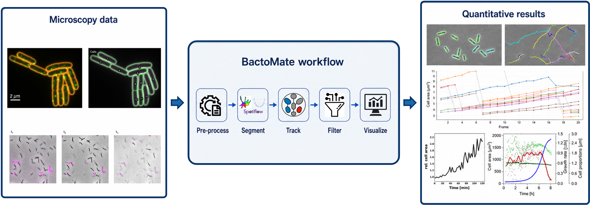
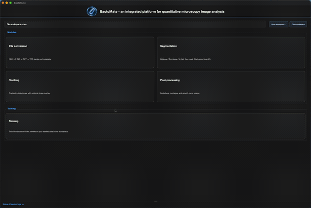

<div align="center">
<p align="center">

<br><br>

</p>
</div>

## What is BactoMate?

**BactoMate** is an integrated microscopy analysis platform for file conversion, segmentation ([Omnipose](https://github.com/kevinjohncutler/omnipose), [Cellpose-SAM](https://github.com/MouseLand/cellpose), U-Net), mask analysis, [tracking](https://github.com/weigertlab/trackastra), **lineage quality control and export**, training, and reporting.

To learn more, check out the [paper](https://www.biorxiv.org/content/10.64898/2026.08.06.743177v1) or watch our [tutorials](https://www.youtube.com/watch?v=Vwot_dErn6g&list=PLYQZb_PwGpYw). For questions or support, please open an [issue](https://github.com/Molinfect/BactoMate) or [contact us](https://www.molinfect.hu-berlin.de).

### Demo
<div align="center"><p align="center">

</p></div>

## Citation

**If you use BactoMate, please cite the [BactoMate paper](https://www.biorxiv.org/content/):**

Hallenga, L., Fornoff, S., Pesch, M., Kohlheyer, D., Ahmada, S., Hör, J., Erhardt, M., Popp, P. F. (2026). BactoMate: an integrated platform for reproducible bacterial microscopy analysis. <em>bioRxiv</em>.


## Installation

**Prefer a ready-made app?** Download **BactoMate.dmg** (macOS) or **BactoMate-win64.zip** (Windows) from the [latest GitHub Release](https://github.com/Molinfect/BactoMate/releases/latest) — no Python or Terminal needed.

**Install from source:** Clone this repository, or download and extract its ZIP archive, then follow the instructions for your operating system below. No build step is required.

## macOS — install and launch

**Requires:** macOS 10.15+, Python 3.11, Terminal.

Open Terminal in the project folder:

```bash
chmod +x setup/macos/*.sh launch_gui.sh
./setup/macos/install.sh
```

Verify:

```bash
source venv/bin/activate
python main.py --version    # BactoMate 2.9.4
python main.py --smoke-test # Smoke test OK
```

Launch:

```bash
./launch_gui.sh
```

## Windows — install and launch

**Requires:** 64-bit Windows 10/11, 64-bit Python 3.11, and the [64-bit Visual C++ Redistributable](https://learn.microsoft.com/en-us/cpp/windows/latest-supported-vc-redist).

Install under your user folder (e.g., `C:\Users\<you>\BactoMate`), not `Program Files`. Do not run as Administrator.

Open Command Prompt in the project folder:

```bat
setup\windows\install.bat
```

Then double-click `launch_windows.bat`, run it from Command Prompt, or launch the installed console command:

```bat
venv\Scripts\activate
bactomate
```

For complete Windows troubleshooting, see **[docs/INSTALL_AND_LAUNCH_windows.md](docs/INSTALL_AND_LAUNCH_windows.md)**.

## Documentation

| Document | Description |
|----------|-------------|
| [setup/README.md](setup/README.md) | Install and launch scripts (start here) |
| [docs/README.md](docs/README.md) | Full user guide, CLI, and workflows |
| [bactomate/scripts/README.md](bactomate/scripts/README.md) | Script reference (GUI subprocesses, CLI tools, diagnostics) |
| [docs/BACTOMATE_USER_MANUAL.md](docs/BACTOMATE_USER_MANUAL.md) | Tab-by-tab reference |
| [docs/RELEASE_NOTES.md](docs/RELEASE_NOTES.md) | Version history |
| [docs/INSTALL_AND_LAUNCH_windows.md](docs/INSTALL_AND_LAUNCH_windows.md) | Windows install details |
| [build/README.md](build/README.md) | **Maintainers only** — package `.app`/DMG or Windows zip |

## Quick troubleshooting

| Issue | Fix |
|-------|-----|
| macOS Qt / PyQt6 errors | Re-run `./setup/macos/install.sh` or `./setup/macos/repair_pyqt6.sh` |
| Windows DLL / torch errors | Install VC++ Redistributable x64, use Python 3.11 64-bit, recreate `venv` |
| ILP tracking says `No module named 'motile'` or `NodeSelection` | Re-run `pip install -r requirements.txt` in the BactoMate `venv` |
| Cellpose segmentation errors | `python setup/apply_all_patches.py` (with venv active) |
| GPU is optional | CPU works; CUDA PyTorch is offered during install |

## License

MIT — see [LICENSE](LICENSE).
